<!-- Guarda este archivo como README.md en el repo: angelhassielgarciabaca-max/angelhassielgarciabaca-max -->
<!-- Los 4 SVG van en la MISMA carpeta (raiz) que este README -->

<div align="center">




<br/>


</div>

---

## `01.` Live Profile Scan

```text
┌──────────────────────────────────────────────────────────────────────────┐
│ ● ● ●        hassiel@github: ~ $ ./profile-scan --verbose                │
├──────────────────────────────────────────────────────────────────────────┤
│ [OK] subject ........ Hassiel García                                     │
│ [OK] handle ......... @angelhassielgarciabaca-max                        │
│ [OK] role ........... Quantitative Analyst & Software Engineer           │
│ [OK] education ...... Economía (UNAM) · Software Eng. (UVEG)             │
│ [OK] languages ...... Python | R | SQL | TypeScript | Bash               │
│ [OK] focus .......... Econometrics | Risk | Algo Trading | Data Eng.     │
│ [OK] status ......... Modeling → Trading → Shipping                      │
│ [OK] location ....... CDMX, México                                               │
│                                                                          │
│ > scanning repositories ████████████████████ 100%                        │
│ > _                                                                      │
└──────────────────────────────────────────────────────────────────────────┘
```

## `02.` About Me

```python
class Hassiel:
    education  = ["B.A. Economics @ UNAM", "Software Engineering @ UVEG"]
    expertise  = ["Financial Econometrics", "Algorithmic Trading",
                  "Quantitative Risk Management", "Scalable Data Pipelines"]
    stack      = ["Python", "R", "SQL", "TypeScript", "React",
                  "Node.js", "Docker", "Ubuntu Linux"]
    mission    = "Turn noisy markets into robust, shippable systems."
```

## `03.` Flagship Systems

### 🛰️ Argus Risk Intelligence System
Real-time quantitative risk monitoring engine for multi-asset portfolios: automated volatility forecasting (**GARCH / EGARCH**), **Monte Carlo VaR** simulations and streaming telemetry alerts.


### ⚡ HFT & Algorithmic Trading Engines
Low-latency execution and market-making algorithms: order book imbalance analysis, statistical arbitrage and execution cost minimization.


## `04.` Systems Dashboards

> Visual previews of my systems. Data shown is **simulated / illustrative**.

<div align="center">

### 🛰️ Argus · Risk Intelligence


*Volatility forecasting (GARCH/EGARCH), VaR and Monte Carlo risk budget for multi-asset portfolios.*

### ⚡ Execution Monitor · Algo Trading


*Order book imbalance, strategy equity curve and key performance and latency metrics.*

### 🧬 Analytics Architecture


*From market feed to dashboard: ingestion, streaming, storage, modeling, API and front-end.*

</div>

## `05.` Tech Stack & Quant Toolkit

| Category | Technologies |
|:--|:--|
| **Languages & Math** | `Python` · `R` · `SQL (PostgreSQL/DuckDB)` · `TypeScript` · `Bash` |
| **Quant & Econometrics** | `Pandas` · `NumPy` · `SciPy` · `Statsmodels` · `QuantLib` · `R (forecast)` |
| **Full-Stack & APIs** | `React` · `Node.js` · `FastAPI` · `Tailwind CSS` · `REST & WebSockets` |
| **Infrastructure** | `Docker` · `Ubuntu Linux` · `Git/GitHub` · `CI/CD` |

<div align="center">


</div>

## `06.` GitHub Analytics

<div align="center">


<br/>


</div>

## `07.` Contact

<div align="center">

[](mailto:angelhassielgarciabaca@gmail.com)
[](https://github.com/angelhassielgarciabaca-max)


<sub>`10110101 01100011 01110011 01001000`</sub>

</div>
